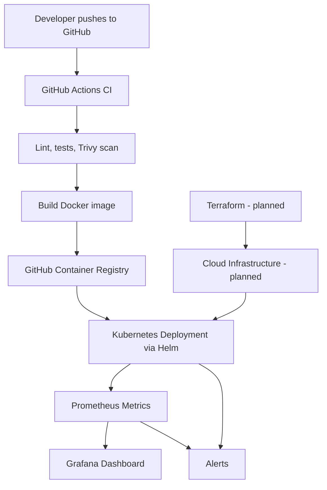

# CloudPulse: Automated Deploy, Monitor, Recover


> **Goal:** Deploy a web application using a complete automated pipeline, monitor it, and recover from deployment failures.

CloudPulse combines the skills that appear most often in DevOps job listings: **Kubernetes, Terraform, Python, cloud, CI/CD, Docker and monitoring**. A small FastAPI service goes through an automated pipeline (lint, test, scan, build, publish), runs on Kubernetes via Helm, is observed with Prometheus and Grafana, and is deliberately broken to prove it can be detected, rolled back and documented like a real incident.

---

## Table of Contents

1. [Project Status](#project-status)
2. [Architecture](#architecture)
3. [Technology Stack](#technology-stack)
4. [Repository Structure](#repository-structure)
5. [Prerequisites](#prerequisites)
6. [Quick Start](#quick-start)
7. [The Application](#the-application)
8. [Containerization](#containerization)
9. [CI Pipeline (GitHub Actions)](#ci-pipeline-github-actions)
10. [Kubernetes and Helm](#kubernetes-and-helm)
11. [Monitoring and Alerting](#monitoring-and-alerting)
12. [Reliability: Failure Drill and Rollback](#reliability-failure-drill-and-rollback)
13. [Security](#security)
14. [Infrastructure as Code (Planned)](#infrastructure-as-code-planned)
15. [Makefile Reference](#makefile-reference)
16. [Troubleshooting](#troubleshooting)
17. [Roadmap](#roadmap)
18. [Lessons Learned](#lessons-learned)
19. [License](#license)

---

## Project Status

| Phase | Status |
|---|---|
| FastAPI app with health, version, error and metrics endpoints | Done |
| Multi-stage, non-root Docker image | Done |
| CI: lint, test, Trivy scan, build, push to GHCR | Done |
| Local Kubernetes (kind) and Helm chart with probes, limits, rolling updates | Done |
| Prometheus and Grafana monitoring, dashboard and alert rules | Done |
| Failure drill, rollback and incident report | Done |
| Deploy workflow in CI (SHA-tagged image, `--atomic`) | Planned |
| Terraform and cloud cluster (AWS EKS or Azure AKS) | Planned |

---

## Architecture



**Flow:**

1. A push to `main` triggers GitHub Actions.
2. The pipeline lints, runs unit tests, builds the image and scans it with Trivy.
3. On `main`, the image is pushed to GHCR tagged with the **commit SHA** (never `latest`).
4. Helm deploys an image tag to Kubernetes using a rolling update.
5. Prometheus scrapes the app through a ServiceMonitor, Grafana visualizes the metrics, and alert rules watch for errors, latency and pods that cannot start.

---

## Technology Stack

| Component | Technology |
|---|---|
| OS and scripting | Linux (Ubuntu on WSL2), Bash, Python |
| Application | FastAPI, Uvicorn |
| Containers | Docker (multi-stage, non-root) |
| CI/CD | GitHub Actions, GitHub Container Registry |
| Orchestration | Kubernetes (kind locally), Helm |
| Monitoring | Prometheus, Grafana, Alertmanager (kube-prometheus-stack) |
| Security | Trivy, non-root pods, hardened security contexts |
| Infrastructure (planned) | Terraform, AWS or Azure |

---

## Repository Structure

```
cloudpulse/
├── .github/
│   └── workflows/
│       └── ci.yml                  # lint, test, scan, build, push
├── app/
│   ├── __init__.py
│   ├── main.py                     # FastAPI application
│   └── tests/
│       ├── __init__.py
│       └── test_main.py
├── docs/
│   ├── incidents/                  # incident reports
│   └── screenshots/                # Grafana and alert screenshots
├── helm/
│   └── app/
│       ├── Chart.yaml
│       ├── values.yaml
│       └── templates/
│           ├── deployment.yaml
│           ├── service.yaml
│           ├── hpa.yaml
│           └── servicemonitor.yaml
├── monitoring/
│   ├── prometheus-values.yaml
│   ├── alert-rules.yaml
│   └── grafana-dashboard.json
├── scripts/
│   └── traffic.sh                  # generates load for dashboards and alerts
├── terraform/                      # planned
├── .dockerignore
├── .gitignore
├── Dockerfile
├── Makefile
├── README.md
└── requirements.txt
```

---

## Prerequisites

| Tool | Purpose | Check |
|---|---|---|
| Git | Version control | `git --version` |
| Python 3.12+ | Run the app and tests | `python3 --version` |
| Docker | Build and run containers | `docker --version` |
| kubectl | Talk to Kubernetes | `kubectl version --client` |
| kind | Local Kubernetes cluster | `kind --version` |
| Helm 3 | Package and deploy | `helm version` |
| make | Shortcut commands | `make --version` |

**Windows users:** use **WSL2 with Ubuntu** and **Docker Desktop** with WSL integration enabled for your Ubuntu distro. Work inside the Linux file system (`~/cloudpulse`), not under `/mnt/c/...`.

First-time Ubuntu setup:

```bash
sudo apt update && sudo apt install -y python3 python3-venv python3-pip git make curl
```

---

## Quick Start

### 1. Run the app locally

```bash
git clone https://github.com/Aryan6394/cloudpulse.git
cd cloudpulse

python3 -m venv .venv
source .venv/bin/activate
pip install -r requirements.txt

python -m pytest -q
uvicorn app.main:app --reload
```

Open <http://localhost:8000/docs> for the API docs.

### 2. Run in Docker

```bash
docker build -t cloudpulse:local --build-arg APP_VERSION=local-1 .
docker run --rm -d --name cloudpulse -p 8000:8000 cloudpulse:local
curl localhost:8000/health
curl localhost:8000/version
docker exec cloudpulse id        # uid=10001(appuser)
docker stop cloudpulse
```

### 3. Run on local Kubernetes

```bash
kind create cluster --name cloudpulse

docker build -t cloudpulse:local-2 --build-arg APP_VERSION=local-2 .
kind load docker-image cloudpulse:local-2 --name cloudpulse

helm upgrade --install cloudpulse ./helm/app \
  --namespace demo --create-namespace \
  --set image.tag=local-2 \
  --atomic --timeout 2m

kubectl -n demo get pods
kubectl -n demo port-forward svc/cloudpulse 8081:80
curl localhost:8081/version
```

kind runs inside Docker and cannot see local images, so every new image must be loaded with `kind load docker-image`.

### 4. Install monitoring

```bash
helm repo add prometheus-community https://prometheus-community.github.io/helm-charts
helm repo update

helm upgrade --install kube-prometheus-stack prometheus-community/kube-prometheus-stack \
  --namespace monitoring --create-namespace \
  -f monitoring/prometheus-values.yaml \
  --version 92.13.1 --timeout 15m

kubectl -n monitoring get pods
```

The first install downloads many images and can take several minutes. If Helm times out while the pods are still starting, wait for them to become `Running` and rerun the same command.

### 5. Load the dashboard and alert rules

```bash
kubectl -n monitoring create configmap cloudpulse-dashboard \
  --from-file=cloudpulse.json=monitoring/grafana-dashboard.json \
  --dry-run=client -o yaml | kubectl apply -f -
kubectl -n monitoring label configmap cloudpulse-dashboard grafana_dashboard=1 --overwrite

kubectl apply -f monitoring/alert-rules.yaml
```

### 6. Open the UIs

```bash
# Prometheus
kubectl -n monitoring port-forward svc/kube-prometheus-stack-prometheus 9090:9090 > /dev/null 2>&1 &

# Grafana (user: admin)
kubectl -n monitoring get secret kube-prometheus-stack-grafana \
  -o jsonpath="{.data.admin-password}" | base64 -d; echo
kubectl -n monitoring port-forward svc/kube-prometheus-stack-grafana 3000:80 > /dev/null 2>&1 &
```

- Prometheus targets: <http://localhost:9090/targets>
- Prometheus alerts: <http://localhost:9090/alerts>
- Grafana dashboard: <http://localhost:3000/d/cloudpulse-main>

Stop all tunnels with `pkill -f "kubectl.*port-forward"`.

### 7. Generate traffic

```bash
kubectl -n demo port-forward svc/cloudpulse 8081:80 > /dev/null 2>&1 &
scripts/traffic.sh 8081 300
```

---

## The Application

A small FastAPI service. It is intentionally simple so the focus stays on the platform around it.

| Method | Path | Description |
|---|---|---|
| GET | `/health` | Liveness and readiness check. Returns `{"status": "ok"}`. |
| GET | `/version` | Returns the running version from the `APP_VERSION` env var. |
| GET | `/error` | Returns HTTP 500, used to trigger error-rate alerts. |
| GET | `/metrics` | Prometheus metrics (request counts, latency histograms). |

### `app/main.py`

```python
import os

from fastapi import FastAPI, HTTPException
from prometheus_fastapi_instrumentator import Instrumentator

app = FastAPI(title="CloudPulse", version=os.getenv("APP_VERSION", "dev"))

Instrumentator().instrument(app).expose(app, include_in_schema=False)


@app.get("/health")
def health():
    return {"status": "ok"}


@app.get("/version")
def version():
    return {"version": os.getenv("APP_VERSION", "dev")}


@app.get("/error")
def error():
    raise HTTPException(status_code=500, detail="Simulated failure")
```

### Tests

`app/tests/test_main.py` covers `/health`, `/version`, the 500 on `/error`, and that `/metrics` exposes `http_requests_total`. Run them with `python -m pytest -q`.

### Dependencies

`requirements.txt` pins exact versions (for example `fastapi==0.162.0`, `uvicorn[standard]==0.54.0`) so the laptop, Docker image and CI all behave the same. Regenerate with `pip freeze` after upgrades and rerun the tests.

---

## Containerization

Design goals: small image, non-root user, reproducible builds, observable endpoints.

```dockerfile
# ---- build stage ----
FROM python:3.12-slim AS builder
WORKDIR /build
COPY requirements.txt .
RUN pip install --no-cache-dir --prefix=/install -r requirements.txt

# ---- runtime stage ----
FROM python:3.12-slim

ARG APP_VERSION=dev
ENV APP_VERSION=${APP_VERSION} \
    PYTHONDONTWRITEBYTECODE=1 \
    PYTHONUNBUFFERED=1

WORKDIR /app

COPY --from=builder /install /usr/local
COPY app ./app

RUN useradd --system --uid 10001 --no-create-home appuser
USER 10001

EXPOSE 8000

HEALTHCHECK --interval=30s --timeout=3s --retries=3 \
  CMD python -c "import urllib.request; urllib.request.urlopen('http://localhost:8000/health')"

CMD ["uvicorn", "app.main:app", "--host", "0.0.0.0", "--port", "8000"]
```

- **Two stages** keep build tooling out of the final image.
- **`USER 10001`** means the app never runs as root.
- **`APP_VERSION`** is set at build time (CI passes the commit SHA), so `/version` reports exactly what is running.

---

## CI Pipeline (GitHub Actions)

`.github/workflows/ci.yml` has two jobs:

| Job | Steps |
|---|---|
| `test` | checkout, set up Python 3.12, install dependencies, `ruff check`, `pytest` |
| `build` | build image tagged with the commit SHA, Trivy scan (fails on HIGH or CRITICAL), log in to GHCR, push (only on `main`) |

Key points:

- `build` runs only if `test` passes.
- Images are tagged with `${{ github.sha }}`, so every deploy and rollback is traceable.
- Pull requests build and scan but never push.
- The push step uses the built-in `GITHUB_TOKEN`, so there are no stored registry credentials. The repo setting **Workflow permissions** must be **Read and write**.
- The image name is lowercased in the workflow because registry names must be lowercase.

### Pinning third-party actions

The Trivy step is pinned to a full commit SHA, not a tag:

```yaml
- name: Trivy scan
  uses: aquasecurity/trivy-action@ed142fd0673e97e23eac54620cfb913e5ce36c25 # v0.36.0
  with:
    image-ref: ${{ env.IMAGE }}:${{ github.sha }}
    severity: CRITICAL,HIGH
    ignore-unfixed: true
    exit-code: "1"
```

In March 2026 the `trivy-action` repository suffered a supply-chain attack in which most of its version tags were repointed at malicious code, and the maintainers then moved all tags to a `v` prefix. This project originally referenced an old tag that no longer existed, so the build failed before running any of that code. The fix was to pin to a commit SHA, which cannot be moved after the fact. Treat third-party actions the same way and check for updates with Dependabot.

---

## Kubernetes and Helm

The chart in `helm/app` deploys the service with production-style settings.

| Requirement | Implementation |
|---|---|
| Health probes | startup, readiness and liveness probes on `/health` |
| Resource limits | requests 100m CPU / 128Mi, limits 500m CPU / 256Mi |
| Rolling updates | `RollingUpdate` with `maxSurge: 1`, `maxUnavailable: 0` |
| Non-root | `runAsNonRoot`, `runAsUser: 10001` |
| Hardened container | read-only root filesystem, all capabilities dropped, no privilege escalation, seccomp `RuntimeDefault` |
| Writable scratch space | `emptyDir` mounted at `/tmp` |
| Autoscaling | HPA template included, disabled locally (needs metrics-server) |
| Monitoring | ServiceMonitor template, enabled by default |

Key values (`helm/app/values.yaml`):

```yaml
replicaCount: 2

image:
  repository: cloudpulse
  tag: local
  pullPolicy: IfNotPresent

resources:
  requests: { cpu: 100m, memory: 128Mi }
  limits:   { cpu: 500m, memory: 256Mi }

strategy:
  maxSurge: 1
  maxUnavailable: 0

autoscaling:
  enabled: false

serviceMonitor:
  enabled: true
```

Useful commands:

```bash
helm lint helm/app
helm template cloudpulse helm/app | less
helm history cloudpulse -n demo
kubectl -n demo describe deploy cloudpulse
kubectl -n demo logs -l app=cloudpulse --tail=50
```

Because `maxUnavailable` is 0, a new pod must become ready before an old one is removed. A broken release therefore leaves the old pods serving traffic.

---

## Monitoring and Alerting

The stack is `kube-prometheus-stack`, installed with the values in `monitoring/prometheus-values.yaml`:

- The ServiceMonitor and rule selectors are opened up so any monitor or rule in the cluster is picked up.
- etcd, scheduler, controller-manager and kube-proxy monitors are disabled, because kind does not expose them and they would fire permanently.
- node-exporter is disabled, because it often fails on kind under WSL. The dashboard uses cAdvisor and kube-state-metrics instead.
- Retention is two days.

### Scraping the app

`helm/app/templates/servicemonitor.yaml` tells Prometheus to scrape `/metrics` every 15 seconds. It carries the label `release: kube-prometheus-stack`. Check **Status → Targets** in Prometheus and look for `serviceMonitor/demo/cloudpulse/0` showing all pods up.

### Dashboard

`monitoring/grafana-dashboard.json` is loaded through a labelled ConfigMap so it is version controlled. Panels:

| Panel | Query |
|---|---|
| Request rate | `sum by (handler) (rate(http_requests_total{namespace="demo",handler!="/metrics"}[1m]))` |
| Error rate (5xx %) | `100 * sum(rate(http_requests_total{namespace="demo",status="5xx"}[1m])) / sum(rate(http_requests_total{namespace="demo",handler!="/metrics"}[1m]))` |
| Latency p95 | `histogram_quantile(0.95, sum by (le) (rate(http_request_duration_seconds_bucket{namespace="demo"}[1m])))` |
| Available replicas | `kube_deployment_status_replicas_available{namespace="demo",deployment="cloudpulse"}` |
| CPU per pod | `sum by (pod) (rate(container_cpu_usage_seconds_total{namespace="demo",container="app"}[1m]))` |
| Memory per pod | `sum by (pod) (container_memory_working_set_bytes{namespace="demo",container="app"})` |

### Alert rules

Defined in `monitoring/alert-rules.yaml` as a `PrometheusRule`:

| Alert | Condition | Severity |
|---|---|---|
| `CloudPulseHighErrorRate` | 5xx ratio above 5% for 1 minute | critical |
| `CloudPulseHighLatencyP95` | p95 latency above 1 second for 2 minutes | warning |
| `CloudPulsePodNotStarting` | any pod waiting in `ImagePullBackOff`, `ErrImagePull` or `CrashLoopBackOff` for 1 minute | critical |
| `CloudPulsePodRestarting` | more than 2 container restarts in 10 minutes | critical |

An "unavailable replicas" alert is deliberately not used for failed rollouts: with `maxUnavailable: 0` the old pods stay available, so that metric never moves. Watching for pods that cannot start catches the failure instead.

### Traffic generator

`scripts/traffic.sh [port] [seconds]` sends steady requests to `/health` and `/version`, with roughly one loop in five also hitting `/error`. That produces an error rate above the 5% threshold and makes every dashboard panel move.

---

## Reliability: Failure Drill and Rollback

The drill proves the system fails safely and recovers.

**1. Baseline**

```bash
helm history cloudpulse -n demo
kubectl -n demo get pods
curl localhost:8081/version
```

**2. Keep traffic flowing**

```bash
scripts/traffic.sh 8081 900
```

**3. Deploy a version that cannot start**

```bash
helm upgrade cloudpulse ./helm/app -n demo --set image.tag=does-not-exist --timeout 1m
kubectl -n demo get pods -w
```

Expected: the new pod goes `ErrImagePull` then `ImagePullBackOff`, while both old pods stay `Running`. Users see no downtime.

**4. Detect**

`CloudPulsePodNotStarting` moves to Pending and then Firing in Prometheus (`/alerts`) after roughly one to two minutes.

**5. Roll back**

```bash
helm history cloudpulse -n demo
helm rollback cloudpulse -n demo --wait
curl localhost:8081/version
```

**6. Automatic rollback with `--atomic`**

```bash
helm upgrade cloudpulse ./helm/app -n demo --set image.tag=does-not-exist --atomic --timeout 90s
```

Helm rolls back by itself when the release does not become healthy. The CI deploy workflow will use this flag.

**7. Document it**

The write-up lives in `docs/incidents/`, using this structure: summary, timeline, impact, root cause, detection, resolution, what went well, what went wrong, and action items.

---

## Security

| Control | How it is implemented |
|---|---|
| Image scanning | Trivy in CI fails the build on HIGH or CRITICAL findings |
| Non-root container | Dockerfile `USER 10001`, enforced again by Kubernetes `runAsNonRoot` |
| Hardened pod | read-only root filesystem, capabilities dropped, no privilege escalation, seccomp |
| No committed secrets | `.env` is in `.gitignore`; the registry push uses the built-in `GITHUB_TOKEN` |
| Pinned dependencies | exact versions in `requirements.txt` |
| Pinned actions | Trivy action pinned to a commit SHA |
| Least-privilege CI | workflow `permissions` set explicitly, with `packages: write` only on the build job |
| Reproducible images | tagged by commit SHA, never `latest` |

Planned: Dependabot for Python, Docker and Actions, secret scanning with Gitleaks, GitHub OIDC for cloud authentication instead of long-lived keys, NetworkPolicy, and Terraform scanning with tfsec or checkov.

---

## Infrastructure as Code (Planned)

Terraform will provision the cloud side of the same pipeline:

- VPC with public and private subnets
- Managed Kubernetes cluster (EKS or AKS) and node group
- Remote, encrypted, locked Terraform state
- IAM role for GitHub Actions using OIDC, scoped to this repository and branch

Everything runs locally on kind first so cloud spend only starts once the chart and dashboards work. Run `terraform destroy` after every demo session and set a billing alert before creating anything.

---

## Makefile Reference

```makefile
.RECIPEPREFIX := >

IMAGE   ?= cloudpulse
TAG     ?= local
CLUSTER ?= cloudpulse

.PHONY: lint test docker kind-up kind-down image-load

lint:
> ruff check .

test:
> python -m pytest -q

docker:
> docker build -t $(IMAGE):$(TAG) --build-arg APP_VERSION=$(TAG) .

kind-up:
> kind create cluster --name $(CLUSTER)

kind-down:
> kind delete cluster --name $(CLUSTER)

image-load: docker
> kind load docker-image $(IMAGE):$(TAG) --name $(CLUSTER)
```

`.RECIPEPREFIX` lets recipes start with `>` instead of a tab.

---

## Troubleshooting

| Symptom | Likely cause | Fix |
|---|---|---|
| `ERROR: "/install": not found` during `docker build` | `requirements.txt` is empty, so pip installs nothing | Fill it in and save, then rebuild |
| `Attribute "app" not found in module "app.main"` | `app/main.py` is empty or unsaved | Save the file and check with `cat app/main.py` |
| `permission denied` on the Docker socket in WSL | user not in the `docker` group, or Docker Desktop WSL integration is off | `sudo usermod -aG docker $USER` and restart WSL, or enable integration for your distro |
| `ensurepip is not available` | `python3-venv` not installed | `sudo apt install python3-venv` |
| `grep` not recognized | running Linux commands in Windows PowerShell | use the Ubuntu terminal |
| `git push` says `src refspec main does not match` | branch is still `master`, or nothing is committed | `git branch -M main` and commit first |
| `Repository not found` on push | the GitHub repo does not exist or the token lacks `repo` scope | create the repo empty, use a Personal Access Token as the password |
| CI: `unable to find version` for an action | tag no longer exists | pin the action to a commit SHA |
| `ImagePullBackOff` locally | image not loaded into kind | `kind load docker-image <image> --name cloudpulse` |
| `address already in use` on port-forward | another process holds the port | use a different local port, for example 8081 |
| `helm upgrade` or install times out for the monitoring stack | images still downloading | check `kubectl -n monitoring get pods`, wait, rerun without `--wait` |
| ServiceMonitor target missing in Prometheus | Service label or port name mismatch | the Service needs `app=cloudpulse` and a port named `http` |
| Dashboard not in Grafana | ConfigMap missing or unlabelled | create it with label `grafana_dashboard=1`, then restart Grafana if needed |
| CloudPulse alerts not listed | `alert-rules.yaml` not applied | `kubectl apply -f monitoring/alert-rules.yaml` |

---

## Roadmap

- [ ] CI deploy workflow with `--atomic` and a post-deploy smoke test
- [ ] Terraform for a cloud cluster with OIDC-based CI access
- [ ] Dependabot and Gitleaks
- [ ] NetworkPolicy and RBAC for the pipeline
- [ ] GitOps with Argo CD or Flux
- [ ] Canary releases with Argo Rollouts
- [ ] Centralized logging with Loki
- [ ] Image signing with Cosign and SBOMs
- [ ] Ingress with TLS via cert-manager

---

## Lessons Learned

- Files that look saved in an editor may be empty on disk. Verify with `cat` or `wc -l` before building.
- A tag is not an immutable reference. Pin third-party actions and images by digest or commit SHA.
- `maxUnavailable: 0` turns a bad deploy into a non-event for users, but metrics based on "unavailable" replicas will not notice it. Alert on pods that cannot start instead.
- Local-first development (kind, then cloud) keeps iteration fast and costs near zero.
- A Helm timeout does not mean the install failed. Check the pods before starting over.

---

## License

Released under the [MIT License](LICENSE).

---

## Author

**Aryan Singh**
[GitHub](https://github.com/Aryan6394)
